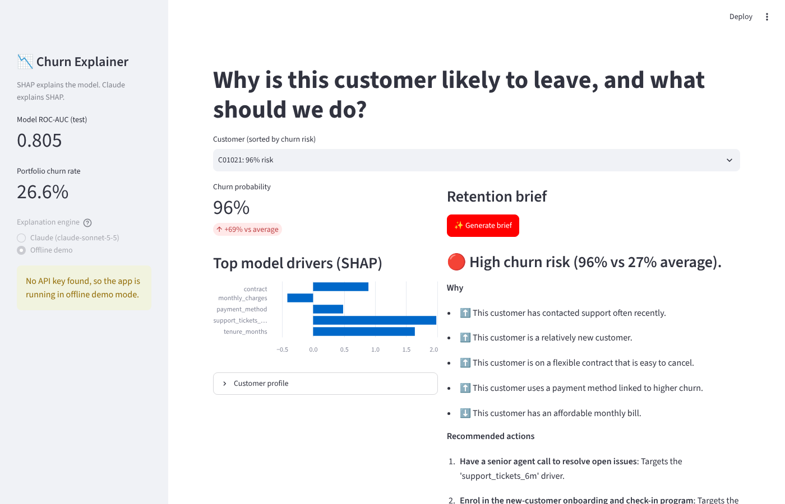

# 📉 Claude Churn Explainer

**Turn black-box churn predictions into plain-English retention plans: SHAP explains the model, and Claude explains SHAP.**



<!-- TODO: replace with a GIF of generating a Claude brief (e.g. recorded with ScreenToGif or Kap) -->

## Why this exists

Churn models are easy to build but hard to act on. An account manager can't do much with "probability 0.87, SHAP value +1.9 for `contract_Month-to-month`". This project takes a classic ML pipeline (gradient boosting + SHAP) and adds **Claude** as a translation layer. Claude reads the model's per-customer explanation and returns a **structured retention brief**: risk level, a one-line headline, the drivers in plain English, and prioritized actions.

## Features

- 🤖 **Churn model**: scikit-learn gradient boosting on a realistic synthetic telecom dataset (ROC-AUC ≈ 0.80)
- 🔍 **Per-customer SHAP explanations**, with one-hot features merged back into readable names
- ✨ **Claude-written retention briefs** using **forced tool use**, so the output is always valid JSON that matches a schema (no text parsing)
- ⚡ **Prompt caching** on the system prompt for cheaper, faster batch runs
- 📊 **Streamlit dashboard** to pick a customer, inspect drivers and generate a brief
- 📝 **Batch CLI** that writes a Markdown report for the top-N at-risk customers
- 🔌 **Offline demo mode**: everything runs without an API key (template briefs), so anyone can try it
- ✅ **Tests** with a fake Claude client, so no API calls happen in CI

## How it works

```
customer data ──► GradientBoosting ──► SHAP values ──► compact JSON ──► Claude (forced tool call) ──► retention brief
                     (churn prob.)      (top drivers)                    submit_retention_brief          ▲
                                                                          schema = output format         └─ Streamlit / CLI
```

Claude never sees a raw data dump, only a small, numeric explanation for one customer. Its system prompt tells it to ground every claim in those numbers, avoid jargon, recommend only actions the company can take, and note that SHAP shows correlation, not proven cause.

## Tech stack

| Layer | Tools |
|---|---|
| ML & explainability | scikit-learn, SHAP, pandas, NumPy |
| LLM | Anthropic Claude API (`anthropic` Python SDK): tool use, prompt caching |
| App | Streamlit |
| Config & testing | python-dotenv, pytest |

## Setup

**Requirements:** Python 3.10+ and (optionally) an [Anthropic API key](https://console.anthropic.com/).

```bash
git clone https://github.com/jamal-uddin537/claude-churn-explainer.git
cd claude-churn-explainer
python -m venv .venv && source .venv/bin/activate   # Windows: .venv\Scripts\activate
pip install -r requirements.txt

cp .env.example .env     # then open .env and paste your ANTHROPIC_API_KEY
```

> 🔐 Your key lives only in `.env`, which is git-ignored. Never commit it.

**Run the dashboard**

```bash
streamlit run app.py
```

**Generate a batch report**

```bash
python report.py --top 5            # uses Claude if a key is set
python report.py --top 5 --offline  # no API calls
```

**Run the tests**

```bash
pytest -q
```

## Project structure

```
claude-churn-explainer/
├── app.py               # Streamlit dashboard
├── report.py            # Batch Markdown report CLI
├── src/
│   ├── data.py          # Synthetic telecom customer generator
│   ├── model.py         # Model training + SHAP explanations
│   └── explainer.py     # Claude tool-use call + offline fallback
├── tests/
│   └── test_pipeline.py # Offline tests with a fake Claude client
├── docs/screenshot.png
├── .env.example
├── requirements.txt
└── LICENSE
```

## What I learned

- Using **tool schemas as output contracts** makes LLM output reliable enough to render in a UI.
- Sending a **compact, pre-computed explanation** instead of raw data keeps prompts small, cheap and grounded.
- An offline fallback plus injectable clients make an LLM app **testable** and easy for others to try.

## Roadmap

- [ ] Swap in a real dataset (e.g. IBM Telco Customer Churn)
- [ ] "What-if" simulator: change a contract or price and re-score
- [ ] Export briefs to CSV/CRM
- [ ] Deploy on Streamlit Community Cloud

## Built with

- **[Anthropic's Claude API](https://platform.claude.com/docs)** generates the retention briefs. The structured-output technique (forcing a tool call whose schema is the desired output) follows the *Tool use* and *Enable JSON mode* recipes in **[anthropics/claude-cookbooks](https://github.com/anthropics/claude-cookbooks)** (MIT License). No code was copied from that repo; the patterns were re-implemented for this project.
- [SHAP](https://github.com/shap/shap), [scikit-learn](https://scikit-learn.org), [Streamlit](https://streamlit.io)

*This is an independent personal project. It is built with Claude, but it is not affiliated with or endorsed by Anthropic.*

## License

[MIT](LICENSE) © 2026 Jamal Uddin
